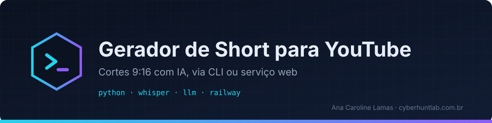

<p align="center"></p>

# Gerador de Short para YouTube — cortes 9:16 com IA (CLI e serviço web)

Cópia do projeto de código aberto **[AI YouTube Shorts Generator](https://github.com/SamurAIGPT/AI-Youtube-Shorts-Generator)**, uma ferramenta de linha de comando em **Python** que recebe um vídeo longo do YouTube (ou um arquivo local) e devolve **Shorts verticais ranqueados por potencial viral**. Ela transcreve o vídeo com Whisper, usa um **LLM** para encontrar e pontuar os melhores trechos e recorta cada um no formato 9:16 para TikTok, Reels e YouTube Shorts.

> **Adição desta cópia:** um servidor HTTP mínimo (`server.py`) que roda o pipeline como serviço web, por exemplo no Railway (`Procfile`).

Documentação original em inglês: [README-en.md](README-en.md).

## Recursos

- **Dois modos**:
  - **API** (padrão): download, transcrição, ranqueamento e recorte via MuAPI, com uma única chave;
  - **Local** (`--mode local`): `yt-dlp`, `faster-whisper`, `ffmpeg` e OpenCV na sua máquina; só a etapa do LLM (OpenAI ou Gemini) é remota.
- **Ranqueamento por viralidade**: o LLM identifica o tipo de conteúdo (podcast, entrevista, tutorial…) e avalia ganchos, picos emocionais, opiniões fortes, revelações, citações e valor prático, com nota de 0 a 100.
- **Vídeos longos**: acima de 30 min, a transcrição é dividida em blocos de 20 min com sobreposição.
- **Deduplicação** de trechos sobrepostos e seleção dos N melhores.
- **Recorte vertical** com rastreamento de rosto (modo local) ou autocrop (modo API).
- **Serviço web** (`server.py`): formulário em `/`, `GET /health`, `GET /api/check-keys` (testa as credenciais dos provedores), `POST /api/shorts` (`{"url", "num_clips", "mode"}`) e `GET /api/shorts/<job_id>` para acompanhar o resultado.
- **Saída** com título, nota, frase de gancho e motivo de cada corte, além de JSON opcional com a transcrição completa.

## Instalação

Requisitos: **Python 3.10+**. Para o modo local, também **ffmpeg** no PATH.

```bash
git clone https://github.com/ticarollamas-arch/Gerador-Short-Youtube.git
cd Gerador-Short-Youtube
python3 -m venv venv && source venv/bin/activate
pip install -r requirements.txt
pip install -r requirements-local.txt   # só para --mode local
cp .env.example .env
```

| Variável | Uso |
|---|---|
| `MUAPI_API_KEY` | Modo API (padrão) |
| `LLM_PROVIDER` | `openai` ou `gemini` (modo local) |
| `OPENAI_API_KEY` / `OPENAI_MODEL` | OpenAI (padrão `gpt-4o-mini`) |
| `GEMINI_API_KEY` / `GEMINI_MODEL` | Gemini (padrão `gemini-2.5-flash`) |
| `LOCAL_WHISPER_MODEL`, `LOCAL_WHISPER_DEVICE`, `LOCAL_OUTPUT_DIR` | Modelo e dispositivo do Whisper e pasta de saída |

## Como usar

```bash
python main.py "https://www.youtube.com/watch?v=VIDEO_ID"                 # modo API
python main.py "https://www.youtube.com/watch?v=VIDEO_ID" --mode local    # modo local
python main.py "/caminho/video.mp4" --mode local                          # arquivo local
python main.py "URL" --num-clips 5 --aspect-ratio 9:16 --output-json result.json
```

| Opção | Padrão | Descrição |
|---|---|---|
| `--mode` | `api` | `api` ou `local` |
| `--num-clips` | `3` | Quantidade de Shorts |
| `--aspect-ratio` | `9:16` | Proporção (ex.: `1:1`) |
| `--format` | `720` | Resolução do download (`360` a `1080`) |
| `--language` | automático | Idioma forçado do Whisper |
| `--output-json` | — | Salva o resultado completo em JSON |

Como serviço web: `python server.py` (escuta em `$PORT`). Para processar vários vídeos: `xargs -a urls.txt -I{} python main.py "{}"`. Os critérios de viralidade, o prompt e o tamanho dos blocos ficam em `shorts_generator/highlights.py`.

## Tecnologias

Python · Whisper / faster-whisper · OpenAI API · Gemini API · MuAPI · yt-dlp · FFmpeg · OpenCV · http.server · Railway

## Créditos

Projeto original: [AI YouTube Shorts Generator](https://github.com/SamurAIGPT/AI-Youtube-Shorts-Generator), de Anil Chandra Naidu Matcha (SamurAIGPT). O aviso de copyright original está preservado em [LICENSE](LICENSE).

## Licença

MIT. Veja [LICENSE](LICENSE) (Copyright © 2026 Anil Chandra Naidu Matcha).
